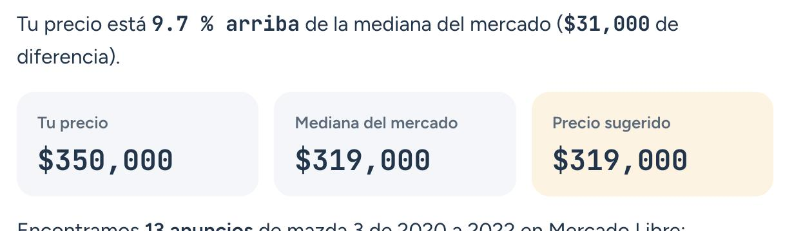

# Bitácora de prompts (PROMPT_LOG) — Assignment 2 · AlumniCar

> **Assignment 3:** las decisiones de diseño, escalabilidad y seguridad del producto final están en el [README, sección "Decisiones de diseño vs. sugerencias del IS"](README.md#decisiones-de-diseño-vs-sugerencias-del-is).

**Deploy (liga de prueba con la función):** https://alumnicar-preview.jolly-night-811e.workers.dev — rama `comparacion-precio` en Cloudflare.
**Sitio oficial:** https://alumnicar.com — sigue en la v1.0, sin la función.

> **Por qué Cloudflare y por qué una liga aparte:** el sitio está en Cloudflare porque el plan gratis de Vercel no permite uso comercial. La función pública pide nombre y correo, y el aviso de privacidad y los términos del sitio todavía no los revisa un abogado. Para no exponer a AlumniCar a un problema legal, la función se prueba en una liga aparte: no aparece en buscadores, lleva un aviso de "versión de prueba" y no está en alumnicar.com. Pasa a `main` hasta tener la revisión legal.
**Repositorio:** https://github.com/matiasrodete/alumnicar-web — rama de trabajo `comparacion-precio`.
**Función:** comparación del precio del vendedor contra el mercado (Mercado Libre vía Apify).

## Paso 1 — Especificación (auditada en la Sesión 19 por Joseph)

### Versión auditada (Sesión 19, sin cambios)

**Qué hace:** Cuando el equipo registra un coche en el panel, la app consulta en Mercado Libre, mediante Apify, los anuncios de la misma marca, modelo y año, calcula la mediana de sus precios y la compara con el precio que pide el vendedor. Muestra "Por encima del mercado" si está más de 10% arriba, "En línea con el mercado" si está dentro de ±10% y "Por debajo del mercado" si está más de 10% abajo, junto con la diferencia en pesos.

**Qué datos necesita:**
- Marca, modelo, año, kilometraje y precio del vendedor (MXN): campos que el equipo captura en el panel con lo que dice el vendedor.
- Precios de referencia: vienen de Apify; nadie los escribe.
- Token de Apify: se lee de una variable de entorno; no va en el código.

**Cómo se sabrá que funciona** (referencia supuesta: mediana de $250,000):
- $300,000 → "Por encima del mercado", $50,000 arriba.
- $260,000 → "En línea con el mercado".
- $275,000 (exactamente +10%) → "En línea con el mercado".
- $200,000 → "Por debajo del mercado", $50,000 abajo.
- Menos de 3 anuncios → "Pocos datos para comparar", sin comparación.
- Precio vacío, en cero o con letras → pide corregirlo y no compara.

### Cambios posteriores y por qué (17 de noviembre)

Los decidí yo al revisar el plan de la IA (Entradas 2 y 3), no para que la especificación coincidiera con lo que ya había construido. La versión auditada de arriba se queda tal cual como referencia.

| Campo | Versión auditada | Cambio | Por qué |
|---|---|---|---|
| Qué hace: quién la usa | "Cuando el equipo registra un coche en el panel" | También el **vendedor**, en "Vende tu coche". Ve su precio, si está arriba o abajo y en qué porcentaje, un **precio sugerido** (la mediana) y la lista de anuncios con los que se comparó. Deja nombre y correo; máximo 3 comparaciones al día. | El vendedor es quien necesita la referencia al decidir su precio, y AlumniCar recibe su contacto. El límite cuida los créditos de Apify. |
| Qué hace: qué anuncios | "de la misma marca, modelo y año" | El mismo año, **uno antes y uno después**. | Con un solo año hay pocos anuncios para comparar. |
| Qué datos necesita | Marca, modelo, año, km y precio | Se agregan **nombre y correo** del vendedor (solo en la versión pública). | Para el límite diario y para que el equipo dé seguimiento. |

Lo demás no cambia: mediana, ±10% (el 10% exacto es "En línea"), mínimo 3 anuncios, precio inválido y token en variable de entorno. Los casos de "Cómo se sabrá que funciona" siguen siendo los mismos.

## Paso 2 — Construcción: aceptar / rechazar / revisar

**Herramienta:** Claude Code

### Entrada 1: fuente de datos
- **Fecha:** 17 de noviembre de 2026
- **Prompt:** "Antes de construir nada más, compárame 3 o 4 fuentes de datos para obtener precios de coches usados en México y compararlos con el precio del vendedor (por ejemplo: Apify con Mercado Libre, la API oficial de Mercado Libre, Kavak, la Guía Autométrica u otra que conozcas). Para cada una dime: de dónde salen los precios, cuánto cuesta, qué tan confiables y actualizados son, qué tan difícil es conectarla y qué riesgos tiene. No escribas código todavía."
- **Qué propuso la IA:** Comparó 4 fuentes:
  - **Apify + Mercado Libre:** anuncios en vivo, unos US$0.09–0.17 por consulta (unas 30 al mes con el plan gratis), ya conectada; son precios que se piden, no de venta.
  - **API oficial de Mercado Libre:** gratis, pero la búsqueda podría estar bloqueada para apps externas desde 2025.
  - **Kavak:** sin API pública; su cotizador da lo que Kavak pagaría, más bajo que el mercado, y extraerlo puede ir contra sus términos.
  - **Guía Autométrica:** referencia de la industria, de paga, mensual, sin API pública y con licencia que probablemente no deja mostrar sus precios en la web.

  Recomendó quedarse con Apify + Mercado Libre.
- **Campo de la especificación en juego:** Qué datos necesita: "Precios de referencia: vienen de Apify".
- **Mi cuestionamiento:** Pesé el riesgo de que en Mercado Libre se publiquen precios más altos de lo que realmente se vende, contra usar una guía tipo libro azul.
- **Decisión:** Acepto Apify + Mercado Libre.
- **Por qué:** Aunque no sean precios de venta, son los precios a los que se están publicando los coches, y cualquier comprador o vendedor saca su referencia y su presupuesto de Mercado Libre; hasta los coches de Kavak se publican ahí.
- **Commit:** `Bitácora: elijo Apify + Mercado Libre como fuente de precios`

### Entrada 2: qué anuncios entran en la mediana
- **Fecha:** 17 de noviembre de 2026
- **Prompt (resumen fiel):** Le pegué mi especificación y le pedí primero su plan. Me presentó 5 puntos donde lo construido no coincidía con mi especificación, y le respondí punto por punto.
- **Qué propuso la IA:** Mantener los filtros que había agregado sin que yo los pidiera: descartar anuncios en otra moneda, de otro año, repetidos y de menos de $10,000 (refacciones). Revisar la lista real de anuncios en el Prompt 3.
- **Campo de la especificación en juego:** Qué hace: "anuncios de la misma marca, modelo y año".
- **Mi cuestionamiento:** Acepté descartar la otra moneda, pero solo el mismo año me pareció muy poco para comparar.
- **Decisión:** Pido revisión. Acepto el filtro de moneda y **cambio el año: el mismo, uno antes y uno después**.
- **Por qué:** Con un solo año hay pocos anuncios. Con ±1 año hay más puntos de comparación y el coche sigue siendo comparable.
- **Commit:** `Comparador público en "Vende tu coche", año ±1 y precio sugerido`
- **Revisión con anuncios reales (Prompt 3, 17 de noviembre):**
  - **Prompt:** "Con un coche real: marca [BMW], modelo [235], año [2015], kilometraje [87,000], precio que quiere el vendedor $[420,00]. Corre la búsqueda real en Mercado Libre y muéstrame la lista completa de anuncios que trajo Apify: cuáles entraron en la mediana y cuáles se descartaron y por qué. Dime la mediana con los filtros actuales. No cambies nada todavía: yo reviso la lista y te digo si hay que ajustar algo."
  - **Qué mostró la IA:** la función no reportaba los descartados, así que agregó un modo revisión que no cambia el resultado (commit `Modo revisión: la función puede reportar los anuncios descartados y su motivo`). Como con "235" solo llegaban 5 anuncios, corrió también "M235i" y "M235i 2015" para tener más qué revisar:

    | Búsqueda | Anuncios de Apify | Mediana sin filtros | Entraron con los filtros de entonces |
    |---|---|---|---|
    | BMW 235 | 5 | $1,198,900 | 0 (todos 2025–2027 o sin año) |
    | BMW M235i | 30 | $729,900 | 0 (24 sin año en el título, 6 de 2024–2026) |
    | BMW M235i 2015 | 17 | $749,000 | **1, y era un "Bmw Serie 5 2015" a $248,000** |

  - **Hallazgos:** el año casi nunca viene en el título, y Apify solo lo trae si se piden los detalles del anuncio. Un modelo distinto se coló a la mediana porque nadie revisaba que el título dijera el modelo. El M235i 2015 (coupé 3.0) y el M235i Gran Coupé 2020+ (2.0) se mezclarían sin un año confiable. Y el precio "420,00" se leía como $42,000.
  - **La IA propuso:** A) exigir el modelo en el título; B) pedir los detalles a Apify para leer el año real (unos US$0.20 por consulta en lugar de US$0.09); C) pedir corregir un precio con la coma mal puesta; D) probar también con un coche más común.
  - **Mi decisión:** **A modificada:** el modelo debe aparecer en el título **o en la descripción**, porque muchos anuncios lo dicen solo en la descripción. **B y C: acepto tal cual. D: rechazo**, porque ya con el token de Apify probé yo mismo en la liga de prueba el ejemplo que trae la página (Mazda 3) y sí dio resultado. El BMW sale con "Pocos datos" por ser un coche con pocas publicaciones, no porque la función falle.
  - **Commit:** `Prompt 3: modelo en título o descripción, año real del anuncio y coma mal puesta`
- **Mediana antes y después del filtro (con los cambios, búsqueda real "BMW M235i", 2015):** Apify trajo 16 anuncios. **Mediana sin filtros: $729,900.** Con los filtros entró **1**: un "Bmw Serie 2 3.0 M235ia M Sport At" **2016 a $335,000**, el único de la misma generación. Antes de los cambios se tiraba por no traer el año en el título. Se descartaron 12 por año (2022–2026) y 3 por no mencionar "M235i" en el título ni en la descripción. Con 1 anuncio no hay mediana: "Pocos datos para comparar", que es lo correcto, porque casi no hay M235i 2014–2016 publicados.

### Entrada 3: dónde aparece la función y quién la usa
- **Fecha:** 17 de noviembre de 2026
- **Prompt (resumen fiel):** Mi respuesta al plan: "Para el punto 1 me gustaría que fuera algo que el cliente o el vendedor lo pueda revisar en la página web […] cuando le piques vende tu coche, puedas llenar este formulario, pongas tu precio […] y ahí se ponga el botón de comparar con el mercado […] encontramos estos listados con estas características, creemos que tu precio está un 10%, un 15% arriba o abajo. Este es tu precio sugerido".
- **Qué propuso la IA:** Al principio, un botón dentro del alta del coche en el panel, solo para el equipo. Cuando pedí que fuera público, me avisó que eso chocaba con mi otra respuesta ("solo administradores") porque cada consulta gasta créditos de Apify. Me dio 3 opciones: público con datos, público sin límite o solo administradores.
- **Campo de la especificación en juego:** Qué hace: "Cuando el equipo registra un coche en el panel".
- **Mi cuestionamiento:** Quería que lo usara el vendedor, sin que cualquiera gastara los créditos de Apify.
- **Decisión:** Rechazo la propuesta del panel. Elijo **público con datos**: el vendedor deja su nombre y correo, puede comparar hasta 3 veces al día y nos llega como contacto nuevo. El equipo sigue sin límite en el panel.
- **Por qué:** El vendedor es quien necesita la referencia al decidir su precio. Pedir el correo cuida el gasto de Apify y nos deja un contacto.
- **Commit:** `Comparador público en "Vende tu coche", año ±1 y precio sugerido`

### Entrada 4: el borde del ±10%
- **Fecha:** 17 de noviembre de 2026
- **Prompt:** "Revisemos la línea del ±10% contra mi especificación. Con una mediana de $250,000, muéstrame qué responde la función, tal cual, para estos precios: $274,999, $275,000, $275,001, $225,000 y $224,999. Según mi especificación, exactamente +10% ($275,000) y exactamente −10% ($225,000) deben decir "En línea con el mercado". Explícame cómo calculas el porcentaje y si el redondeo puede cambiar el resultado. Si algo no cumple, dime qué cambiarías antes de tocar el código."
- **Qué propuso la IA:** Corrió los 5 precios con la función real:

  ```
  $274,999 {"estado":"en_linea","mensaje":"En línea con el mercado","diferencia":24999,"porcentaje":10, …}
  $275,000 {"estado":"en_linea","mensaje":"En línea con el mercado","diferencia":25000,"porcentaje":10, …}
  $275,001 {"estado":"arriba","mensaje":"Por encima del mercado","diferencia":25001,"porcentaje":10, …}
  $225,000 {"estado":"en_linea","mensaje":"En línea con el mercado","diferencia":25000,"porcentaje":-10, …}
  $224,999 {"estado":"abajo","mensaje":"Por debajo del mercado","diferencia":25001,"porcentaje":-10, …}
  ```

  Explicó que la etiqueta se decide con números enteros y sin dividir, así que el redondeo no la cambia. Señaló un problema en cómo se muestra: el porcentaje redondeado dice "10" en los cinco casos, y el mensaje que le llega al equipo diría "Por encima del mercado (+10%…)" para $275,001. Propuso usar la misma frase que la página ("poco más del 10 %") y agregar una prueba.
- **Campo de la especificación en juego:** Cómo se sabrá que funciona: "$275,000 (exactamente +10%) → En línea con el mercado".
- **Mi cuestionamiento:** Aunque la IA dijo que el redondeo no cambia el resultado, pedí más profundidad: siempre puede haber un caso que no estamos planeando, y quiero limitar esos casos por más insignificantes que sean.
- **Decisión:** Acepto la regla del ±10% y pido el cambio, con más profundidad. Al revisar más casos, la IA encontró y corrigió dos más:
  - Una diferencia de $10 se veía como "igual a la mediana". Ahora dice "menos del 0.1 % arriba".
  - Si la mediana sale del promedio de dos anuncios con centavos, puede traer medio centavo. Ahora la comparación se hace en milésimas de peso para no redondearla.

  También agregó 7 pruebas del borde, incluida una que revisa cada peso entre $220,000 y $280,000. Son 36 en total y todas pasan.
- **Por qué:** La especificación pide que el 10% exacto sea "En línea". Además, el porcentaje que ven el vendedor y el equipo nunca debe contradecir la etiqueta.
- **Commit:** `Borde del ±10%: el texto del porcentaje nunca contradice la etiqueta`

## Paso 3 — Validación contra la especificación

**Deploy probado:** https://alumnicar-preview.jolly-night-811e.workers.dev — responde: sí — fecha: 17 de noviembre de 2026. La función `comparar-precio` ya está publicada en Supabase con la versión de la rama.

El token de Apify (`APIFY_TOKEN`) está guardado como secreto en Supabase y la tabla `comparaciones` está creada. Las búsquedas de abajo son reales, en Mercado Libre.

### Caso 1: coche real
- **Input exacto:** marca: BMW · modelo: 235 · año: 2015 · km: 87,000 · precio: $420,000. Lo capturé en "Vende tu coche" de la liga de prueba.
- **Output real (copiado tal cual de la página):**

```
Pocos datos para comparar
```

- **Lo que hay detrás** (modo revisión de la función, misma búsqueda): Apify trajo 5 anuncios de "BMW 235" y no entró ninguno. Todos son M235 Gran Coupé o Serie 2 de 2025 a 2027, fuera del rango 2014–2016.
- **Veredicto:** Aceptar.
- **Razón:** La especificación dice "Menos de 3 anuncios → Pocos datos para comparar, sin comparación", y eso mostró: no inventó una mediana con coches nuevos que cuestan casi tres veces más ($869,900 a $1,246,400). Además, con el mismo coche escrito "420,00", la página respondió "Revisa el precio: escribe solo números mayores a cero, por ejemplo 350000." en lugar de compararlo como $42,000.

### Caso 2: borde del 10% (precio = mediana × 1.10)
- **Input exacto:** [mismo coche] · precio: $[mediana × 1.10]
- **Output real:** no se puede correr con este coche. Para el BMW 235 2015 no hay mediana real: Mercado Libre no tiene 3 anuncios de 2014 a 2016.
- **Por qué decidí dejarlo así:** ya con el token de Apify, probé yo mismo en la liga de prueba el ejemplo que trae la página (Mazda 3) y sí me dio resultado con anuncios reales. Entiendo que el BMW sale con "Pocos datos" porque es un coche con pocas publicaciones, y sé que con coches más comunes la función sí está funcionando. Por eso no corrí un segundo coche para este caso (opción D, rechazada en la Entrada 2).
- **Prueba real con el Mazda 3 (cerca del borde):** Mazda 3, 2021, precio $350,000, en la liga de prueba. Output real de la página (captura abajo):

```
Tu precio está 9.7 % arriba de la mediana del mercado ($31,000 de diferencia).
Tu precio $350,000 · Mediana del mercado $319,000 · Precio sugerido $319,000
Encontramos 13 anuncios de mazda 3 de 2020 a 2022 en Mercado Libre:
```

  

  Con una mediana real de $319,000, la función encontró 13 anuncios del año pedido ±1 y calculó bien la diferencia: $350,000 − $319,000 = $31,000, que es 9.7%, dentro del ±10%. El borde exacto para este coche sería $350,900 (mediana × 1.10), y no lo corrí.
- **Evidencia del borde exacto:** la misma lógica publicada pasa las pruebas del borde con la mediana de $250,000 de la especificación ($275,000 y $225,000 → "En línea con el mercado"; ver la Entrada 4 y la validación con datos simulados abajo).
- **Veredicto:** Aceptar.
- **Razón:** Con datos reales el precio a 9.7% de la mediana queda dentro del ±10% y la diferencia ($31,000) y el porcentaje coinciden con la cuenta a mano. El 10% exacto está cubierto por las pruebas de la Entrada 4; con datos reales no corrí exactamente $350,900.

### Validación previa con datos simulados (no es el deploy)

Probé la página en mi computadora con la función real, pero con 10 anuncios inventados de Mazda 3 en lugar de llamar a Apify. Mazda 3 2021, 52,000 km. Entraron 7 anuncios de 2020 a 2022, y quedaron fuera uno de 2019, uno de 2023 y uno sin año. Mediana: $399,000. Lo que mostró la página:

```
$450,000 → Por encima del mercado | Tu precio está 12.8 % arriba de la mediana del mercado ($51,000 de diferencia). | Precio sugerido $399,000
$438,900 (exactamente +10%) → En línea con el mercado | Tu precio está 10.0 % arriba de la mediana del mercado ($39,900 de diferencia).
$438,901 → Por encima del mercado | Tu precio está poco más del 10 % arriba de la mediana del mercado ($39,901 de diferencia).
$359,100 (exactamente −10%) → En línea con el mercado | Tu precio está 10.0 % abajo de la mediana del mercado ($39,900 de diferencia).
$359,099 → Por debajo del mercado | Tu precio está poco más del 10 % abajo de la mediana del mercado ($39,901 de diferencia).
$399,010 → En línea con el mercado | Tu precio está menos del 0.1 % arriba de la mediana del mercado ($10 de diferencia).
$399,000 → En línea con el mercado | Tu precio es igual a la mediana del mercado.
4.ª comparación con el mismo correo → Ya hiciste 3 comparaciones hoy con este correo. Intenta mañana o escríbenos y te ayudamos con el precio.
abc → Revisa el precio: escribe solo números mayores a cero, por ejemplo 350000.
```

Con la mediana de $250,000 de mi especificación, los casos dan: $300,000 → Por encima (+$50,000), $260,000 → En línea, $275,000 → En línea, $200,000 → Por debajo (−$50,000), 1 anuncio → Pocos datos para comparar, y "", "0" o "abc" → pide corregir el precio. Pasan las 41 pruebas automáticas (`node --test supabase/functions/comparar-precio/comparar-precio.test.mjs`).

## Por qué esta función resuelve el problema

Antes, AlumniCar fijaba el precio con el vendedor sin una referencia objetiva: dependía de lo que el vendedor creía que valía su coche, y un precio fuera de mercado se descubría hasta que el coche no se vendía. Mi especificación pide que la app "calcula la mediana de sus precios y la compara con el precio que pide el vendedor" y muestre "Por encima", "En línea" o "Por debajo del mercado" "junto con la diferencia en pesos", con precios que "vienen de Apify; nadie los escribe". Eso hace la función: el vendedor ve, **antes de publicar**, si su precio está fuera de mercado, en qué porcentaje y cuál sería un precio sugerido, y AlumniCar recibe su contacto para darle seguimiento. La evidencia del Paso 3 muestra que la línea del ±10% se cumple, incluido el caso de "$275,000 (exactamente +10%) → En línea con el mercado". [Completar con el resultado de los Casos 1 y 2 con un coche real.] Lo que todavía no resuelve: el kilometraje no se usa para elegir anuncios, y los precios de Mercado Libre son de publicación, no de venta.

## Pendientes conocidos antes de pasar a producción

- **Aviso de privacidad:** la versión pública pide nombre y correo, y el aviso de privacidad del sitio todavía es un borrador pendiente de revisión legal. Antes de publicar la función para el público, hay que terminarlo y que lo revise un abogado.
- **Costo de Apify:** con el plan gratis alcanzan unas 30 comparaciones al mes. Si el comparador público se usa mucho, hay que pagar Apify o traer menos anuncios por consulta.
- **Kilometraje:** se pide pero no filtra anuncios. Mejora pendiente.
- **Tiempo de respuesta:** con los detalles de Apify, una búsqueda real tardó entre 29 y 59 segundos. El límite de la función es de unos 100 segundos; si Mercado Libre trae muchos anuncios podría acercarse.
- **Nombre del modelo:** el vendedor debe escribirlo como se publica en Mercado Libre ("M235i" encuentra más que "235").
- **El correo no se verifica:** alguien podría usar correos distintos para pasar el límite de 3 al día. El límite de 10 por conexión lo frena, pero no del todo.

## Uso de IA

**Herramientas:** Claude (chat) y Claude Code.

**Para qué las usé:**
- **Claude (chat):** para planear. Me ayudó a redactar la especificación de 3 campos a partir de mi idea, preparar los prompts para Claude Code y armar la estructura de esta bitácora. También **revisé contra la rúbrica**: le pasé resúmenes del avance y me dijo qué me faltaba (evidencia real en el deploy, el Prompt 3 con datos reales, separar la versión auditada de los cambios, el párrafo del porqué, el aviso de privacidad como pendiente).
- **Claude Code:** para el código. Escribió e integró la función en mi repositorio, creó la rama `comparacion-precio`, corrió las pruebas automáticas, probó la página en el navegador, publicó la función en Supabase y la liga de prueba en Cloudflare, e hizo los commits de cada decisión.

**Qué decidí o verifiqué yo:**
- Elegí la función y definí las reglas: mediana, ±10% y mínimo de 3 anuncios.
- Antes de elegir la fuente pedí comparar 4 opciones y me quedé con Apify + Mercado Libre, porque es la referencia que usan compradores y vendedores (Entrada 1).
- Pedí que el token nunca fuera en el código y que la versión publicada no se tocara: trabajo en la rama `comparacion-precio`, separada de alumnicar.com.
- Al revisar el plan rechacé que fuera solo para el equipo en el panel: lo quiero en "Vende tu coche" para el vendedor, con porcentaje, precio sugerido y la lista de anuncios. Cuando la IA me avisó que eso chocaba con "solo administradores", elegí pedir nombre y correo con un máximo de 3 comparaciones al día (Entrada 3).
- Cambié el filtro de año a ±1 año y mantuve el filtro de moneda (Entrada 2).
- En el borde del ±10% pedí más profundidad aunque la IA dijo que no había margen de error; salieron dos casos más que se corrigieron (Entrada 4).
- Revisé la lista real de anuncios del BMW: acepté pedir el año real y corregir la coma mal puesta, modifiqué el filtro del modelo para que valga el título o la descripción, y rechacé probar con otro coche (Prompt 3, Entrada 2).
- Corrí yo los casos en la liga de prueba (BMW y Mazda 3) y comparé el resultado con mi especificación (Paso 3).
- Decidí no pasar la función a alumnicar.com hasta que un abogado revise el aviso de privacidad y los términos.
